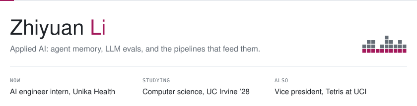
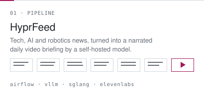
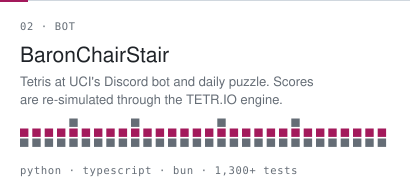
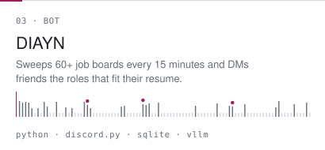
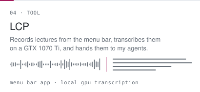

<a href="https://betanine.dev"><picture><source media="(prefers-color-scheme: dark)" srcset="cards/header-dark.svg"></picture></a>

<picture><source media="(prefers-color-scheme: dark)" srcset="cards/hyprfeed-dark.svg"></picture>
<a href="https://puzzle.tetrisatuci.org"><picture><source media="(prefers-color-scheme: dark)" srcset="cards/baronchairstair-dark.svg"></picture></a>

<a href="https://github.com/FakeZhiyuanLi/DIAYN"><picture><source media="(prefers-color-scheme: dark)" srcset="cards/diayn-dark.svg"></picture></a>
<a href="https://github.com/FakeZhiyuanLi/LCP"><picture><source media="(prefers-color-scheme: dark)" srcset="cards/lcp-dark.svg"></picture></a>

